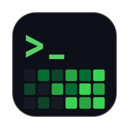
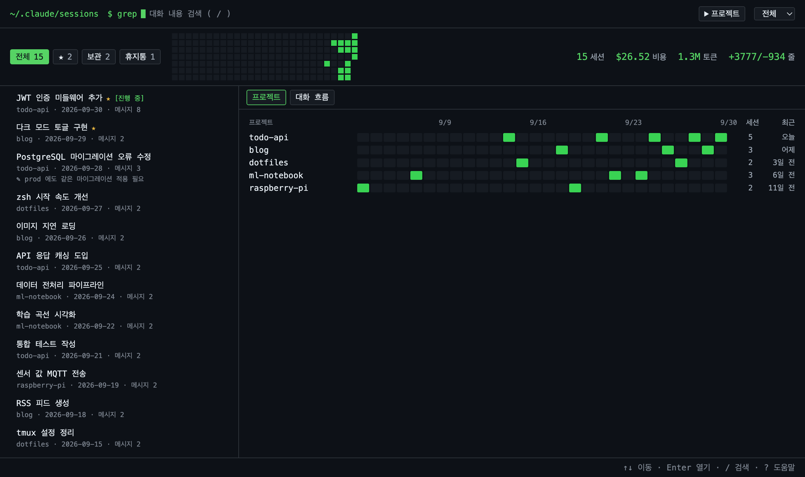
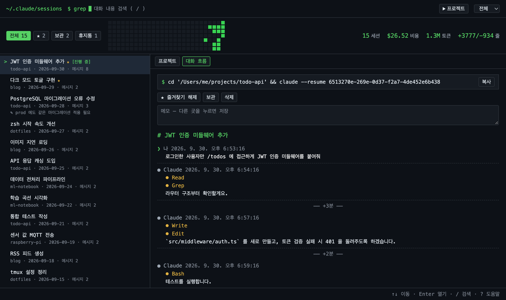

<p align="center"></p>

<h1 align="center">Claude Session Viewer</h1>

<p align="center">
Claude Code 가 <code>~/.claude/projects/</code> 에 남기는 세션 기록을<br>
검색하고, 한눈에 훑어보고, 보관·정리하는 로컬 뷰어 (macOS 앱 / 브라우저)
</p>





> 스크린샷은 데모용 가짜 데이터입니다. Anthropic 의 공식 도구가 아닙니다.

## 기능

- **검색** — 모든 세션의 대화 내용을 전문 검색하고, 어디에 나왔는지 미리보기로 보여줍니다.
- **활동 잔디** — 날짜별 세션 수를 GitHub 잔디처럼 보여줍니다. 칸을 누르면 그날로 필터링됩니다.
- **프로젝트 잔디** — 프로젝트 × 날짜 격자로 어떤 프로젝트를 언제 작업했는지 보여줍니다.
- **대화 흐름** — 한 세션의 메시지와 도구 호출(`Bash`, `Edit` …)을 시간순으로 보여주고, 메시지 사이 경과 시간을 표시합니다.
- **이어서 작업하기** — `cd '<폴더>' && claude --resume <id>` 명령을 한 번에 복사합니다.
- **즐겨찾기 · 메모** — 세션에 별표와 메모를 달고 모아볼 수 있습니다.
- **보관** — Claude Code 는 오래된 세션을 자동으로 정리합니다(`cleanupPeriodDays`, 기본 30일). 보관한 세션은 별도 폴더에 복사돼 원본이 지워져도 남고, 필요하면 원래 위치로 되살려 다시 `--resume` 할 수 있습니다.
- **휴지통** — 삭제는 휴지통으로 옮기는 것이라 되돌릴 수 있습니다. 영구 삭제는 휴지통에서만 할 수 있습니다.
- **요약 숫자** — 필터된 세션의 개수, 비용, 토큰, 추가/삭제한 줄 수.
- **키보드 조작** — 아래 단축키 표 참고.

## 설치

### macOS 앱

필요한 것: macOS 13 이상, Xcode 또는 Command Line Tools (`xcode-select --install`)

```bash
git clone https://github.com/wnsrud2002/claude-session-viewer.git
cd claude-session-viewer
app/build.sh            # → ~/Applications/Session Viewer.app
```

Spotlight(⌘Space)에서 "Session Viewer" 로 실행합니다. 앱은 빈 포트에 서버를 띄우고, 창을 닫으면(강제 종료돼도) 서버도 함께 종료됩니다. 다른 폴더에 설치하려면 `app/build.sh <폴더>`.

### 브라우저

필요한 것: Python 3.9 이상 (외부 패키지 없음)

```bash
python3 sessions.py     # → http://127.0.0.1:8765
```

## 단축키

| 키 | 동작 |
|---|---|
| `↑` `↓` / `j` `k` | 목록 이동 |
| `Enter` | 대화 흐름 열기 |
| `/` | 검색 |
| `Esc` | 검색 지우기 · 선택 해제 |
| `s` | 즐겨찾기 |
| `a` | 보관 |
| `n` | 메모 |
| `x` | 선택 (Shift+클릭으로 범위 선택) |
| `Delete` | 삭제 (휴지통 보기에서는 영구 삭제) |
| `?` | 도움말 |

## 데이터를 다루는 방식

- **읽는 곳:** `~/.claude/projects/*/*.jsonl`. 보기만 할 때는 `~/.claude` 의 파일을 바꾸지 않습니다. (보관한 세션의 원본이 바뀌었으면 목록을 열 때 보관본만 갱신합니다.)
- **쓰는 곳:** 즐겨찾기·메모·보관·휴지통은 `~/.claude` 밖의 `~/.claude-session-viewer/` 에 저장합니다 (Claude Code 의 자동 정리 대상이 되지 않도록).
- **세션 하나 = 네 경로:** 삭제·복원·보관 때 세션에 딸린 `projects/<p>/<id>.jsonl`, `projects/<p>/<id>/`, `file-history/<id>/`, `session-env/<id>/` 를 함께 옮기거나 복사합니다. 여러 세션이 함께 쓰는 `history.jsonl` 은 절대 건드리지 않습니다.
- **안전장치:**
  - 최근 5분 안에 기록된 세션(진행 중일 수 있음)은 한 번 더 확인한 뒤에만 삭제합니다.
  - 복원할 자리에 같은 세션이 이미 있으면 덮어쓰지 않고 거부합니다.
  - 원본이 없어 보관본이 유일한 사본이면, 보관 해제 전에 한 번 더 확인합니다.
- **네트워크:** 서버는 `127.0.0.1` 에만 열리고, `Host` 헤더를 확인해 DNS rebinding 을 막습니다. 파일을 바꾸는 요청은 전용 헤더가 있어야 처리해 다른 사이트의 요청(CSRF)을 막습니다. 외부로 나가는 요청은 없습니다.

## 설정 (환경변수)

| 변수 | 기본값 | 용도 |
|---|---|---|
| `SV_CLAUDE_DIR` | `~/.claude` | 세션 기록 위치 |
| `SV_STORE_DIR` | `~/.claude-session-viewer` | 즐겨찾기·메모·보관·휴지통 저장 위치 |
| `SV_PORT` | `8765` | 서버 포트 |

## 구조

```
sessions.py        서버 + 세션 파싱 + 보관·휴지통 (Python 표준 라이브러리만)
index.html         화면 전체 (vanilla JS, 외부 라이브러리 없음)
test_sessions.py   테스트
app/               macOS 앱 (Swift, WKWebView) 과 아이콘·빌드 스크립트
```

## 테스트

```bash
python3 -m unittest
```

## 라이선스

[MIT](LICENSE)
